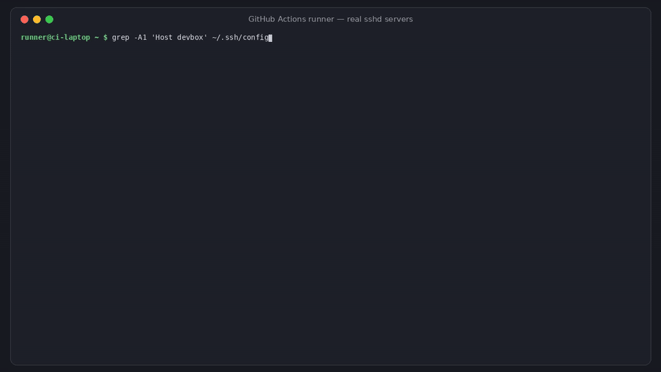

# sshleash

[](https://github.com/hamarshehmhmd/sshleash/actions/workflows/ci.yml)
[](LICENSE)


**An SSH agent firewall.** `sshleash` sits in front of your `ssh-agent` so forwarded agents, dev containers,
sandboxes and AI coding tools only get the keys and hosts your policy allows. You get a prompt or a log line for
every signature, saying which key, which host, through which forwarded machine, and which local program asked.



```bash
pipx install git+https://github.com/hamarshehmhmd/sshleash
```

## Why

`ssh -A` and `ForwardAgent yes` give the remote machine your whole agent. Root there, and every process of your
user (an AI agent, say), can log in anywhere your keys can for as long as you're connected. More and more tools set
this up for you:

- **ChatGPT Desktop / Codex** remote sessions can forward your SSH agent, so *"the agent running on a remote machine
  can authenticate using your local SSH credentials ... it can push to your private repos on GitHub"*
  ([Hacker News, Nov 2026](https://news.ycombinator.com/item?id=50422628); see the opt-in `--forward-ssh-agent` proxy
  mode in [openai/codex#28131](https://github.com/openai/codex/pull/28131)).
- **Docker sandboxes (`sbx`)** forwarded the host's agent into the sandbox: an agent with its own GitHub identity
  happily cloned a private repo as its owner ([The SSH Security Hole in Docker Sandboxes](https://rupertrutledge.com/posts/docker-sbx-s-ssh-security-issue/)).
- **DevPod and friends** write `ForwardAgent yes` blocks straight into `~/.ssh/config` (same HN thread).
- Hardware keys help, but *"you have no way of telling what you're verifying, especially if some tool helpfully
  forwarded your agent"*. And from the same thread: *"auto-forwarding your agent to foreign machines is not the
  right balance. At least not without being able to filter and approve individual signing requests."*

OpenSSH has had the data to make that decision since 8.9: before using the agent, `ssh` sends a
[`session-bind@openssh.com`](https://www.openssh.com/agent-restrict.html) message with the destination's host key and
a flag saying whether the connection is a forwarded one. The stock agent only uses it for keys added with
`ssh-add -h` destination constraints, which few people set up and which most third-party agents don't support. sshleash
uses it to filter every request. It speaks the standard agent protocol, so it can sit in front of other agents
(1Password, Bitwarden, gpg-agent); CI tests it against OpenSSH's `ssh-agent`.

## What it does

| | |
|---|---|
| **Filters keys** | Hide keys from a forwarded machine or a program (`ssh-add -l` there doesn't show them). |
| **Filters signatures** | Per key, destination host, forwarded hop (`via`), requesting program (and its parents), and kind (`ssh-auth` login, `sshsig` git commit signing + namespace). |
| **Asks** | `confirm` pops up ssh-askpass / zenity / kdialog / macOS dialog: *"Allow key 'work' to log in to git@github.com? Requested through a FORWARDED agent on devbox."* No dialog program or no answer means deny. Optional `remember`. |
| **Knows the host** | Host keys are mapped to names through your `known_hosts` (hashed entries too) plus built-in GitHub, GitLab and Bitbucket keys. On a forwarded channel, only binds the real agent verified are trusted, so a remote can't claim to be logging in somewhere else. |
| **Blocks agent management** | Forwarded machines can't add or remove keys or lock your agent. |
| **Logs** | One JSON line per decision (`~/.local/state/sshleash/log.jsonl`) plus `sshleash log`. |
| **Audits** | `sshleash audit` finds `ForwardAgent` on wildcard hosts and tool-written blocks, unfiltered agents, being on a remote host with a forwarded agent, and running AI tools that have your `SSH_AUTH_SOCK`. |

## Usage

```bash
sshleash init            # writes ~/.config/sshleash/policy.toml (starter policy) and prints these steps
sshleash run &           # listens on ~/.ssh/sshleash.sock, relays to your current $SSH_AUTH_SOCK
```

Forward the filtered socket instead of your real agent (OpenSSH lets `ForwardAgent` take a socket path):

```sshconfig
Host devbox
  ForwardAgent ~/.ssh/sshleash.sock
```

Give it to programs you don't fully trust:

```bash
SSH_AUTH_SOCK=~/.ssh/sshleash.sock codex
```

Or point everything at it with `export SSH_AUTH_SOCK=~/.ssh/sshleash.sock`. Process rules (`process = ["codex*"]`)
match the requesting program *or any parent*, so `git push` run by an AI agent still counts as the agent.

A policy is a list of rules; the first match wins ([full example](examples/policy.toml)):

```toml
[[rule]]
name = "the deploy key never leaves this laptop"
key = "deploy-*"
forwarded = true
action = "deny"

[[rule]]
name = "forwarded agents: GitHub only, and ask"
forwarded = true
host = ["github.com"]
action = "confirm"

[[rule]]
name = "forwarded agents: nothing else"
forwarded = true
action = "deny"

[default]
action = "allow"
```

Check a rule without touching anything:

```console
$ sshleash explain --policy examples/policy.toml --key work --host prod-db --via devbox
DENY  (rule: forwarded agents: nothing else)
policy: examples/policy.toml
```

Audit (exit code 1 on `high` findings, `--fail-on medium` to be stricter, `--json` for scripts):

```console
$ sshleash audit --config examples/ssh_config
HIGH   Host *.lab: ForwardAgent yes hands your whole agent to every matching host
MEDIUM Host myws.devpod: DevPod turned on agent forwarding; anything running there (including AI agents) can sign with your keys
MEDIUM SSH_AUTH_SOCK points at an unfiltered agent holding 2 key(s) (2 usable without a touch); ...
```

## Demo

The demo video (on the [v0.1.0 release](https://github.com/hamarshehmhmd/sshleash/releases/tag/v0.1.0)) shows the
audit, git signing allowed and denied, and a real two-hop run recorded on a CI runner with two `sshd` servers:
laptop to devbox with the agent forwarded through sshleash, then devbox to gitserver. On devbox, `ssh-add -l` only
shows the laptop key, and the login to gitserver is refused:

```
DENY    login runner@gitserver with laptop-key ED25519 SHA256:…  via forwarded agent on devbox  by ssh < bash (pid …)  [laptop key: no logins from devbox onwards]
```

CI runs that same scenario on every push ([`tests/test_e2e_sshd.py`](tests/test_e2e_sshd.py), [`demo/twohop.sh`](demo/twohop.sh)).

## Limits

- Forwarding detection needs an OpenSSH **8.9+** client on your machine (it sends the session-bind). Older clients,
  and tools that pass your socket around without ssh, show up as `forwarded = false`. Match them by `process` instead.
- The destination is known when the remote ssh is 8.9+ (session-bind or host-bound auth). Otherwise it is `unknown`,
  and you can write rules for `host = ["unknown"]`.
- Tested against OpenSSH's `ssh-agent`. Agents that don't implement `session-bind@openssh.com` still work, but
  binds sent from a remote machine can't be verified, so those destinations show up as `unknown`.
- Linux and macOS. Requesting-program detection uses `SO_PEERCRED` / `LOCAL_PEERPID`.
- sshleash doesn't hold keys. Anything that can read your real agent socket can still skip it. Keep the real socket
  out of untrusted environments, and use hardware keys for the keys that matter.

## Development

```bash
python -m venv .venv && .venv/bin/pip install -e . pytest
.venv/bin/pytest -q                                  # unit + real ssh-agent tests
SSHLEASH_E2E=1 .venv/bin/pytest tests/test_e2e_sshd.py   # needs an sshd binary
```

## License

GNU Affero General Public License v3.0 or later ([LICENSE](LICENSE)), SPDX `AGPL-3.0-or-later`.

**Commercial licenses** without the AGPL obligations are available from the author, Mohammad Hamarsheh
([@hamarshehmhmd](https://github.com/hamarshehmhmd)). Open an issue or get in touch via GitHub.
